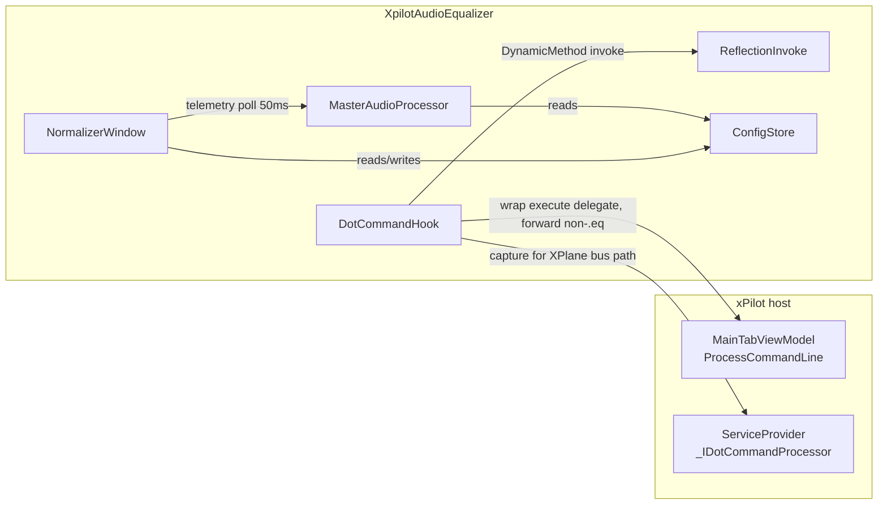

# Architecture

## Why reflection + DynamicMethod invoke

xPilot exposes no public API for the voice pipeline or dot commands, and ships
as a trimmed single-file bundle. The plugin therefore hooks private runtime
state via reflection instead, and every hook is best-effort: resolve → wrap in
try/catch → `PostDebugMessage("[AudioNormalizer] …")` on failure, never throw
into the host.

Trimming (verified against the shipped bundle manifest + stack traces from
live host runs):

| Missing from host | Plugin answer |
|---|---|
| `MethodBase.Invoke` (trimmed) | `ReflectionInvoke`: DynamicMethod + IL call. LIMIT: the dynamic method is owned by our assembly, so host-framework signature types (e.g. Avalonia `DispatcherPriority`) don't resolve at JIT time — `Dispatcher.Post` falls back to a direct call |
| `System.IO.FileSystem.Watcher`, mtime APIs (`GetLastWriteTimeUtc`, `FileInfo`) | `ConfigStore` polls by content compare on a 1 s timer; `FileStream`-only I/O (no `File.ReadAllText`/`WriteAllText`/`Move`) |
| `System.Text.Json` serializer core (hollowed) | Hand-rolled camelCase JSON (`NormalizerJson`): flat doubles/bool/string only, unknown keys ignored, everything through `Clamp()` |
| `Volatile` float/bool/long overloads (`MissingMethodException`) | Plain field access in `NormalizerTelemetry` (best-effort meters) and the `ConfigStore` tick counter |
| Tuple deconstruction in `foreach` over `ValueTuple` | Direct member access (`ch.headset`, `ch.T`) |
| `System.Buffers` facade (`System.Buffers.Binary` missing) | `SpanAction<T,TArg>` defined locally in `MasterAudioProcessor` |
| `Avalonia.Markup.Xaml`, `System.Xaml` | Code-built UI only; no XAML, no compiled bindings |

Our `xPilot.PluginSdk` copy must stay identical to the host's `IBroker` —
verified by diffing member lists against the extracted host assembly (the prior
drift: host had `SendPrivateMessage`/`SendRadioMessage`, ours didn't — added,
with `NotConnectedException` already in our `Exceptions/`).

## Audio normalization (DSP only — no pipeline hook)

There is no voice-pipeline hook: xPilot's trimmed runtime cannot host
`Reflection.Emit` proxies for the internal `ISampleSource` interfaces, so
`MasterAudioProcessor` + `ChannelNormalizerDsp` are wired, tested, and ready
but not yet inserted into the live audio path. Re-adding a hook means solving
proxy creation without Emit first.

- 1920-sample buffers are split stereo: COM1 left / COM2 right, each with its
  own `ChannelNormalizerDsp`. Anything else goes through the left DSP alone.
- `MasterAudioProcessor` holds 4 DSPs (headset L/R, speaker L/R); static
  `SpanAction<float,object>` entry points, no per-frame closure allocation.

## Dot-command hook

`DotCommandHook` wraps `MainTabViewModel.ProcessCommandLine(string)` — the real
1-arg UI entry — and captures `_dotCommandProcessor` (MainTab field +
`ServiceProvider._IDotCommandProcessor` singleton) for the X-Plane + forward
path. `HandleCommand(cmd, resultHandler)` intercepts `.eq …`; everything else
follows `ForwardToOriginal`: live view-model `ProcessCommandLine` first, then
the captured processor's 2-arg `Process(command, resultHandler?)` (signature
verified via MetadataLoadContext against the host bundle), then the callback.

Why not an `IDotCommandProcessor` proxy for the UI path: the interface exists
in the host (same 2-arg `Process`), but replacing the field wholesale races the
host's own construction order and the trimmed runtime's proxy support is
untested for interface dispatch ordering — wrapping the delegate keeps the
original pipeline intact and only diverts `.eq`.

Verbs: `show|hide|on|off|toggle|target|preset|status|reset`; unknown input posts
usage. **Breakage point:** xPilot renames `MainTabViewModel`,
`ProcessCommandLine`, or `MessagesAreaViewModel._mainTabViewModel` →
`[AudioNormalizer] .eq commands unavailable: MainTabViewModel not found.`

## DSP chain

One `ChannelNormalizerDsp` per channel, per `ProcessChannel` call (nominal
48 kHz, 960-sample frames; all smoothing scaled by `1000·n/SampleRate` so
behavior is buffer-size invariant):

1. **DC blocker + measure** — single in-place pass: high-pass
   (`α = 0.99738`), RMS + peak. Digital silence (`peak < 1e-6`) eases gain to
   unity and reports `-∞`.
2. **Adaptive noise floor + hysteresis gate** — floor tracks down fast
   (`0.80^scale`), up slowly (`0.9995^scale`), floored at `NoiseFloorDb`.
   Gate opens when `rms > GateOpenDb && rms > 1.25·floor`, closes below
   `GateCloseDb`. No `GateCloseDb − 3 dB` invariant: `NormalizerSettings.Clamp`
   enforces `GateClose ≤ GateOpen − 3`.
3. **AGC target** — `Δ = Target − envelopeDb`; gain is full leveling far from
   target blending to a `CompressionRatio` slope near it
   (`leveling = 0.75 + 0.25·min(1, |Δ|/8)`), clamped to `±MaxBoost/MaxCut`.
   Pre-limiter pulls gain back if `peak·gain` would exceed 95% of the ceiling.
4. **Ballistics + soft limiter** — per-sample attack (downward moves) / release
   (upward, and always when the gate is closed so boosted whispers fade instead
   of snapping); cubic-knee soft limit from `0.75·ceiling` to `ceiling`
   (`LimiterCeilingDb`, −6..−0.1).

`MasterAudioProcessor` holds 4 DSPs (headset L/R, speaker L/R);
`GetAggregateTelemetry` aggregates only channels with a telemetry timestamp
(inactive stereo-right DSPs sit at gain 0 and must not pin the meter), with
gain keeping its sign (loudest-abs wins). `Enabled == false` short-circuits —
buffers pass through untouched.

## Config

`NormalizerSettings` is an immutable record; `Clamp()` bounds every knob
(`Target −30..−6`, `Boost/Cut 0..24`, `Ratio 1..10`, `Attack 1..100 ms`,
`Release 50..1500 ms`, `GateOpen −60..−25`, `GateClose ≤ Open−3 down to −65`,
- File lives next to the DLL (`<dll-dir>/normalizer-config.json`); missing or
  corrupt → Balanced defaults.
- `Update()` swaps under lock, fires `SettingsChanged` synchronously, and
  debounces disk writes 250 ms via timer; writes are atomic (tmp + stream-copy
  rename, since `File.Move` is trimmed) and stamp `_lastSelfWriteTicks` +
  `_lastSeenContent` so the 1 s content-compare poller ignores its own echo.
  External edits (hand-edit, `.eq`, UI) flow through the same path. No
  `FileSystemWatcher`, no STJ — both trimmed from the host.

## UI

`NormalizerWindow` is code-built Avalonia (no XAML — xPilot's trimmed Avalonia
build drops things like `ToggleButton.IsCheckedChanged`,
`SelectingItemsControl.SelectionChanged`, `RangeBase.ValueChanged`, and
single-arg `CornerRadius`; the code uses only the `PropertyChanged`-on-property
and overload shapes that survive trimming — keep to that pattern). Live level
meters + telemetry timer, status line removed; enable checkbox, preset
dropdown, 8 sliders, `Reset to Defaults` / `Close`.

- Any slider/`target` change stamps `PresetName = "Custom"` (except explicit
  preset picks); `Reset to Defaults` restores Balanced.
- Plugin entry (`AudioEqualizerPlugin`) never touches Avalonia types at JIT
  time: window create/show/hide/close go through `NoInlining` `*Late` methods,
  and UI-thread hops resolve the host dispatcher via reflection
  (`FindDispatcherType`/`FindPostMethod`). `SessionEnded` tears down hooks,
  allows window destroy, disposes config.

- `ChannelNormalizerDspTests` — pure-DSP facts. Convention: synthesize a sine frame at
  calibrated dBFS (`peak = ToLinear(rmsDb)·√2`), loop ~25 frames so envelopes
  settle, assert output-RMS window (`-18 ± 2.5 dB` after a −3 dBFS blast, etc.),
  plus limiter-ceiling, gate-block, stereo-independence, and silence-eases cases.
- `RuntimeInteropSmokeTests` — dot-command routing against `FakeBroker` /
  `FakeDotCommand`, span-callback normalization + `< 1024 B` per-frame
  allocation check, `Initialize` posts-loaded + session teardown, plus
  bundle-gated `SkippableFact`s: extract `AFV.Sdk.Net.dll` / `xPilot.dll`
  from the local single-file bundle
  (`…\org.vatsim.xpilot\Application\xPilot.exe`) by parsing the bundle footer
  directly (never shell out), cache to `%TEMP%\xpilot-equalizer-smoke`, skip
  when the bundle is absent.
